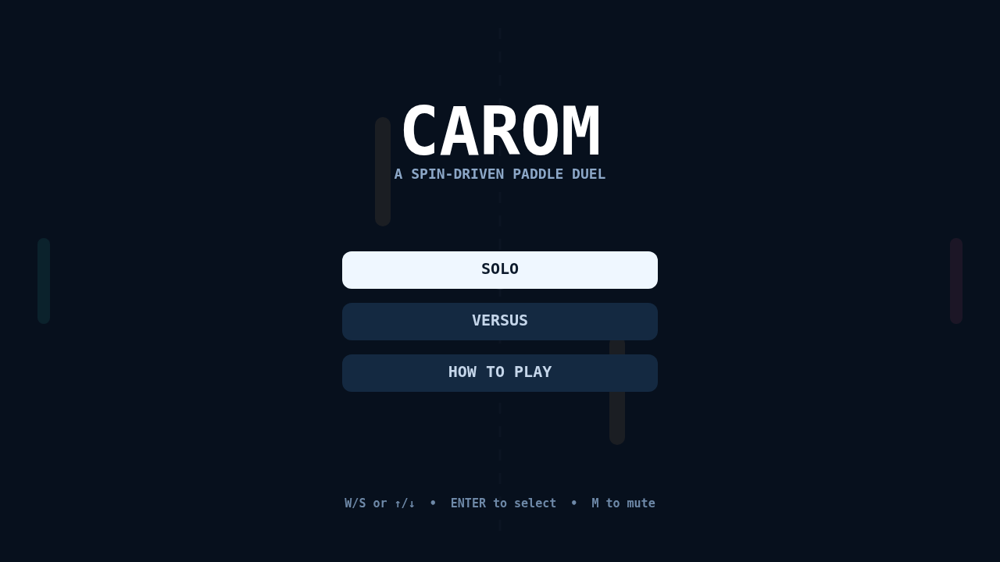
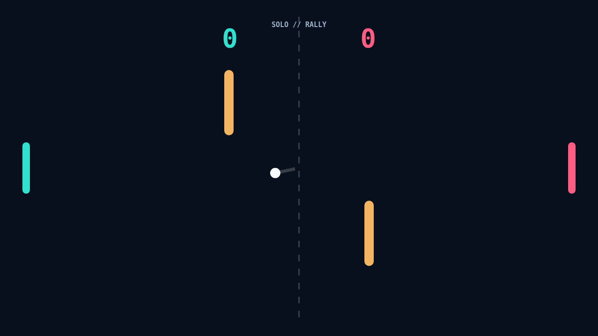

# Carom

Carom opens with a clean, neon-lit court and a ball waiting at center. Pick
Solo to face the reactive returner or Versus to share the keyboard, then keep
the rally alive until the first player reaches match point.

The paddle is more than a blocker: its motion at contact gives the ball spin.
Meet it high or low to change the angle, and carry a moving paddle through the
hit to bend the flight after it leaves your side.

Two gold bank obstacles make every exchange a small geometry puzzle. A shot
can rebound off a bar, curl from spin, clip the top or bottom wall, and arrive
at a surprising height. Read the trail, set your paddle early, and close out
the match with a two-point lead.

